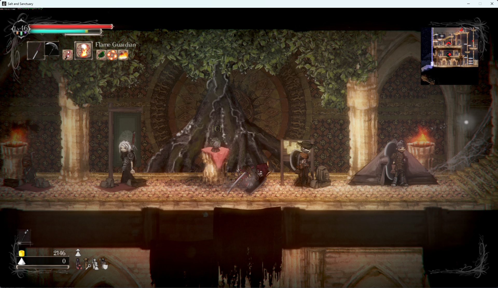
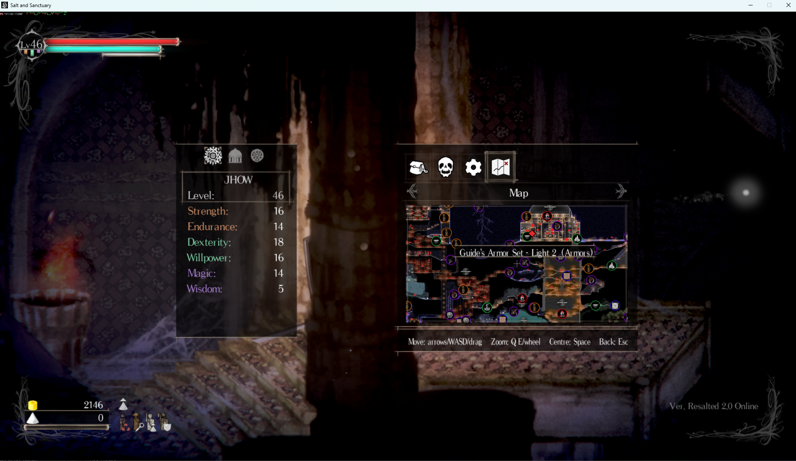

<h1 align="center">SaltMap</h1>

  <b>A minimap and a full world map for <i>Salt and Sanctuary</i>.</b> 
  Icons for items, bosses, NPCs and sanctuaries that clear as you play, and a ring on where to go next.

  
  
  

  <a href="https://github.com/Buzzed-Lightyear/SaltMap/releases/latest"><b>Download</b></a> ·
  <a href="#install">Install</a> ·
  <a href="#controls">Controls</a> ·
  <a href="#troubleshooting">Troubleshooting</a> ·
  <a href="docs/README.md">Docs</a>

<table>
  <tr>
    <td width="50%"></td>
    <td width="50%"></td>
  </tr>
  <tr>
    <td align="center">The minimap, tucked into the HUD's corner</td>
    <td align="center">The map page in the Escape menu</td>
  </tr>
</table>

## Features

- **Minimap** in the top-right corner that follows you, with several zoom levels.
- **Map page** in the Escape menu, next to the bag, skull and gear: pan and zoom across
  the whole world, with area names and the name of any icon you point at.
- **Icons that keep up with your save.** Items and bosses disappear once you collect or
  beat them. NPCs show where they stand now, and sanctuaries are named after their area
  and the creed that holds them.
- **Where next.** The next step of the main route gets a gold ring, with an arrow at the
  minimap's edge when it is off screen. Optional bosses, side stories and hidden
  sanctuaries get blue rings once they open up.
- **Completion counts** for items, bosses and sanctuaries.
- **Enemies** near you as red dots, with bosses ringed.
- **Keyboard, mouse and controller**, on buttons the game leaves free.

## Install

1. Download `SaltMap-<version>.zip` from the [latest release](https://github.com/Buzzed-Lightyear/SaltMap/releases/latest) and extract it.
2. Close the game and double-click **`Install.cmd`**.
3. Start the game. The minimap shows up in play; the map is the new icon in the Escape menu.

The first install also downloads the map pictures (about 120 MB) from the SSMap project.
After a Steam update of the game, run `Install.cmd` again.

**Uninstall:** right-click `uninstall.ps1` in the same folder and choose *Run with
PowerShell*. It puts the original game back.

Installer options and the settings file: [docs/setup.md](docs/setup.md).

## Controls

| | Keyboard / mouse | Controller |
| --- | --- | --- |
| Show / hide or zoom the minimap | M, `=` and `-` | D-pad Up (near, far, hidden) |
| Open the map page | Esc, then the map icon | Back / Select |
| Move around the map | Arrows, WASD or drag | Left stick |
| Zoom the map | Q and E, mouse wheel | Right stick, or LB RB / LT RT |
| Choose which icons show | F (Shift+F back) | D-pad left / right |
| Guide: all, main route only, off | G | Y |
| Centre on yourself | Space | A |
| Back to the menu | Esc | B |

## Troubleshooting

**The game crashes with "Sorry, an error occurred" when you quit.**
This is a bug in the game itself, not the mod. It happens in the game's exclusive
fullscreen mode, and players have reported it on the game's Steam bug board since April
2025 ([thread](https://steamcommunity.com/app/283640/discussions/2/592895054280977074/)).
The same mode can also crash at launch when the game window is not in front. SaltMap 0.4.5
and later work around both. You can also avoid them by setting the game's video option
*Fullscreen* to *Borderless*. Details: [docs/fullscreen-crash.md](docs/fullscreen-crash.md).

**The installer can't find the game.**
Open a command prompt in the extracted folder and run
`Install.cmd -GameDir "D:\path\to\Salt and Sanctuary"`.

**The minimap is gone after a game update.**
The update replaced the game's `salt.exe`. Run `Install.cmd` again.

**An icon or the guide looks wrong.**
[Open an issue](https://github.com/Buzzed-Lightyear/SaltMap/issues) and attach
`Mods\SaltMap.log` from the game folder. Opening the map page also writes
`marker-status.tsv`, `save-flags.txt` and `guide-status.txt` there, which help too.

## Credits

- **Map pictures, icons and positions:** [SSMap](https://github.com/Kaszub09/SSMap) by
  Kaszub09 and contributors, built on the screenshot map of the world by
  [u/magicofgames](https://www.reddit.com/r/saltandsanctuary/comments/f0t1sa/ultimate_map_still_wip_well_no_but_actually_yes/).
  SSMap has no licence, so SaltMap does not include it: the installer downloads it from
  its own repository. Keep it for personal use.
- **Main route** for the guide: the [Fextralife wiki's Game Progress Route](https://saltandsanctuary.wiki.fextralife.com/Game_Progress_Route).
- [Harmony](https://github.com/pardeike/Harmony) and [Mono.Cecil](https://github.com/jbevain/cecil),
  both MIT, ship in the release zip.

Curious how it works, or want to build it yourself? See the [docs](docs/README.md).

## License

SaltMap's own code is [MIT licensed](LICENSE); the downloaded SSMap data is not covered by
it. SaltMap is a fan project, not affiliated with Ska Studios, and contains no game files.
